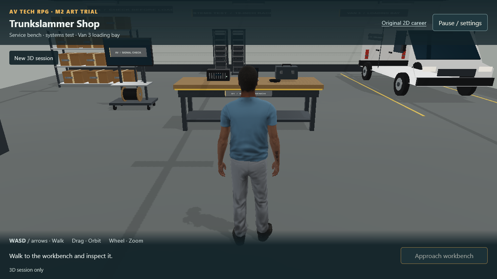
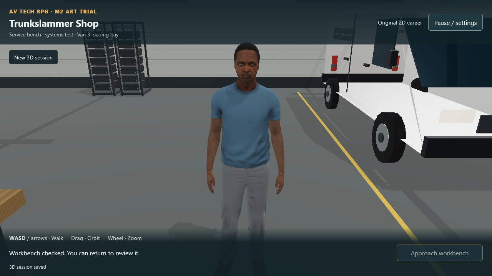

# M2 / P0.4-A — character and first shop art

Issue: [#3](https://github.com/11anthonym/av-tech-rpg/issues/3).
Branch `codex/m2-character-shop-spike` starts at M1
`a32f209c327d6c6d6b382c2492798fb58ab21deb` and targets
`codex/m1-production-3d-client`. PR #2 remains unmerged. No deployment or
deployment-policy changes are part of this work.

## Implemented

The existing Babylon client loads Rocketbox Andre, converted by Avatar Studio
and adapted reproducibly into a 1.78m clothed adult technician. Five skinned
meshes share 80 joints. Face, skin, clothing folds and shoes use actual textured
geometry. The collision capsule remains independent and hidden. Missing rig or
clips produce a recoverable error; there is no visible proxy substitution.

Native Idle/Walk crossfade over roughly 0.25s. World speed is 1.4m/s; cadence
uses actual collision-resolved travel and source stride length. Horizontal root
travel is removed. Heading changes are bounded to 8rad/s. Blocked movement
blends to idle; pause and hidden tabs suspend animation. Movement turns use
smooth heading and the walk clip, not a separately sourced turn-in-place clip.

Original PBR shop art includes the service bench with receiver, laptop and
patch lead; 19-inch racks with rails/ports/status indicators; staging shelves
and taped cartons; dispatch counter; concrete, masonry and industrial fittings;
and Van #3 with shaped cab/body, glazing, tyres/hubs, bumpers, door hardware,
labels and loading-lane markings. Geometry is baked by material. M1 collision
envelopes and bench action remain; the rear racks gain one broad collider.
No tool, carry, loading, driving or career gameplay is added.

## Rights and reproduction

The shipping [asset notice](../../../game3d/public/assets/ASSET_LICENSES.md)
links exact grants, sources, attribution and full license copies.
[Character build](character-build.json) and [lighting build](lighting-build.json)
pin original/runtime hashes and record transformations.

| Asset | Original bytes | Runtime bytes |
| --- | ---: | ---: |
| Andre GLB | 12,701,036 | 1,493,336 |
| Studio Small 09 HDR | 1,615,248 | 66,132, prefiltered `.env` |
| Engineering toolcase | 768 | unchanged |

The human embeds 11 1K WebP images (quality 90), reduced from 11 2K source maps.
Their RGBA8-with-mips estimate drops from 235 MiB to 58.7 MiB; this estimates
texture storage, not measured GPU allocation or total process memory.
Source validation had 22 warnings for missing
tangents and non-root skinned nodes; processed validation has **zero errors and
zero warnings**. MikkTSpace needed normal-orthogonal tangent fallbacks at two
degenerate vertices. No runtime decoder download is needed.

From `game3d`, install with `pnpm install --frozen-lockfile`. Rebuild character:
`node scripts/prepare-technician.mjs [optional-original-glb]`; the source SHA-256
is checked first. To rebuild lighting, start `pnpm dev`, then run
`node scripts/bake-lighting.mjs` in another terminal. A lighting rebake may
differ between graphics implementations; record/review its new hash. Normal
installs/builds neither fetch nor regenerate art.

## Verification and visual acceptance

Code verified: `db91ac0c29bb15e7929a76bba9ce3c302c8a6fab`.
[Clean-checkout CI](https://github.com/11anthonym/av-tech-rpg/actions/runs/45062885260)
passed on 2026-11-22. It installs the committed lockfile, typechecks/builds both
variants and tests the staged production artifact. No deployment ran.

| Check | Result |
| --- | --- |
| `pnpm install --frozen-lockfile`, clean Ubuntu/Node 24 CI | Passed |
| `pnpm test` | 10 passed: 8 domain/save contracts and 2 artifact checks |
| `pnpm build`, `pnpm build:portable` | Passed, including strict TypeScript for source/tests/config |
| `xvfb-run --auto-servernum pnpm test:browser`, software Mesa CI | **19 passed**: 9 Chromium, 9 Firefox, 1 portable-root |
| `node scripts/qa-all.js`, local Windows | 43 static-script and 43 unit checks passed; full legacy browser smoke passed |
| `node scripts/capture-m2.mjs`, local Firefox | Actual keyboard/mouse gameplay, screenshots and measurements captured; zero JS/console/HTTP errors |
| `M2_VIDEO=1 node scripts/capture-m2.mjs` | Actual walking/turning recording captured and sampled for visual QA |

The browser checks retain M1 interaction, camera, collision, focus/pause,
storage-denial/corrupt-save and legacy-root checks. Added checks verify actual
bone-pose/clip-frame changes during travel, blending to idle against a collider,
save/reload at that exact resting point, frozen animation during pause and
visible failures for a missing human or lighting asset. A low-speed collision
resting-point discrepancy was found and fixed: save validation now allows the
engine's observed ~2cm collision tolerance rather than resetting that position.

Local Chromium headless-shell startup stalled and a full local-suite attempt
was interrupted when the automation service restarted. Chromium now selects
Playwright's full/new-headless channel; the complete final browser result above
is the clean Linux CI run. Local Firefox integration checks and full legacy
smoke also passed. Tests do not establish owner visual acceptance.

## Actual browser evidence

- [Normal follow camera](shop-follow.png), [walking pose](technician-walking.png).
- [Face/clothes close view](technician-front.png), [workbench](workbench.png),
  [Van #3/loading bay](van-loading-bay.png).
- [50-second walking/turning gameplay excerpt](walking-turning.webm).
  It is an unsped-up excerpt from the recorded game, not an offline render.
  Keyboard input turns/walks in four directions and approaches the bench.
  The VP9 container is 960×540 at 25 encoded frames/s; repeated frames from the
  software renderer mean this is **not** evidence of 25 rendered FPS.

The committed excerpt trims original seconds 24–74, removing startup. It was
re-encoded without changing elapsed time (`-ss 24 -t 50 -c:v libvpx-vp9 -crf 32
-b:v 0 -deadline realtime -cpu-used 6`). `video.json` records the output hash;
rerunning capture produces a new full recording, not an identical excerpt.

The face, normal anatomy, clothes and separate shoes are visible. Sampled
recording frames at original 30/50/65 seconds show forward travel, side-facing
stride and the bench approach without inversion or ragdoll pose. Standing soles
are aligned to the flat floor; native gait and camera near obstacles still need
owner motion review. Source footwear is not a work-boot asset. No carry/tool
pose is represented as implemented. The workbench action uses its existing UI.

## Measured limits

Raw observations: [browser measurements](browser-measurements.json),
[build sizes](build-size.json), [video metadata](video.json).

| Observation | Measured value |
| --- | --- |
| Browser/viewport | Firefox 159.0, 1280×720, WebGL 2 |
| Host | Windows 10.0.26100 VM, QEMU CPU, 4 logical cores, 12,864,364,544 bytes RAM |
| Renderer | ANGLE / Microsoft Basic Render Driver, Direct3D11 **software rendering** |
| Local first interactive | 15,641ms in a fresh browser context; local preview, caches not deliberately flushed |
| Last 180 frame intervals after gameplay/zoom | p50 374ms; p95 755ms; p99 1,047ms; max 1,097ms |
| Scene geometry / observed draw calls | 20,458 vertices; 60 at close view, 67 initially, including shadows |
| Human geometry | 4,246 vertices; 7,153 triangles; 5 meshes, 80 joints |
| Embedded human images | 11 × 1024² WebP, 938,510 bytes encoded; ~58.7 MiB RGBA8+mips estimate |
| Deployable build, excluding source maps | 166 files, 4,722,922 bytes; sum of per-file gzip estimates 2,106,548 bytes |
| Largest JS chunk | 765,123 bytes; Vite's >500kB warning remains visible |
| Runtime errors | Zero captured JS exceptions, console errors or HTTP failures |

These software-VM timings are slow and are **not a playable target-device
performance pass**. Automated screenshots and close-up pixel fill also affect
frame intervals. The 100ms simulation cap slows travel under heavy stalls;
animation uses the same capped clock to avoid a real-time gait outrunning that
travel, and uses zero time scale during pause to prevent resume jumps.
Hardware GPU allocation is not measured; the texture figure is an estimate,
not process/GPU memory. Build gzip values are estimates, not hosted transfers.

Browser warnings are preserved in the JSON: deprecated renderer-info access,
lazy cube-face initialization and software depth-comparison filtering behavior.
Shadow aliasing, simple procedural surfaces and the faceted van remain visible
art limitations. No threshold was relaxed to turn these observations into an
art or performance acceptance claim.

## Known limits

- Source Idle/Walk are genuine; carrying, tool interaction and turn-in-place
  clips are absent. Workbench inspection still uses the M1 UI action.
- Footwear is ordinary dark source shoes, not modeled safety boots or certified
  PPE. Uniform branding, tool belt, grasping hands and facial animation are absent.
- No foot IK, stair/slope solver or hand collision exists. This is a flat-floor
  qualification. Tight pivots can slide feet; arms can intersect equipment at
  the fixed capsule boundary. Clip coverage and owner motion review remain open.
- Shop kit is generic procedural art. The van is an exterior with opaque
  glazing, a broad collider and closed doors; cargo interior, suspension,
  steering and loading animation are absent. The roof is open for camera
  visibility. Surface maps are modest procedural textures, not scan assets.
- Camera obstruction remains M1's single ray. Sphere sweeping and automatic
  human fade are unqualified; van/shelving corners need owner review.
- Automated software WebGL is functional evidence, not real-GPU FPS acceptance.
  Hosted load timing, Safari, mobile/touch and integrated-GPU performance remain
  unqualified. M2 awaits owner review of the moving character and furnished shop.

Next smallest art task: review this browser scene, then source/author matching
work boots and in-place turning before carry/interact clips. Keep M3 deferred.
