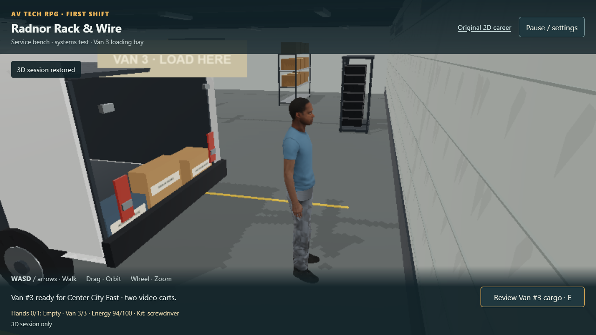

# M3 — interactive shop and Van #3

## State and branch dependencies

Live preflight on 2026-11-22 found `main` at `489b8ec`, M1 PR #2 open at
`a32f209`, and M2 PR #4 open at `372cd28`. No other open development PR or
external implementation superseded them. The in-progress camera/preferences
work was preserved separately in PR #5 (`4b8ec56`), whose clean CI passed.

M3 branch: **`codex/m3-shop-van`**, stacked PR **[#6](https://github.com/11anthonym/av-tech-rpg/pull/6)**.
Dependency order: **#2 → #4 → #5 → #6**. No PR was merged or force-pushed.
The owner explicitly requested M3 while final M2 art/real-device acceptance
remains open. This record does not silently mark those gates accepted.

## What is playable

1. Walk to the real rigged supervisor behind the dispatch counter and get the
   existing “We're Already Late” two-cart assignment. Review is idempotent.
2. Walk to staging. Briefing is required; the next canonical group is offered:
   **Cart frame boxes**, **Display boxes**, **Accessory tote**.
3. Pick up one group. It moves from the shelf to the technician's arms. Hands
   hold one group; another pickup is rejected without a second energy charge.
4. Carry it to the open rear of Van #3. Loading transfers that same object into
   a visible cargo slot, clears the hands and updates progress. Repeat for 3/3.
5. Reload while carrying or after 1, 2 and 3 loads. The exact groups, energy,
   briefing and kit are restored. The objective ends at **ready for Center City
   East**. There is no nonfunctional departure button or claim of M4 travel.

The starter is the prototype's Alex (`prototype-tech`), who already owns a
`screwdriver`. Inspecting the bench reviews that kit rather than duplicating it.
The domain uses the original shop capacity **1**, Van #3 capacity **3**, pickup
energy **2**, and carrying-speed ratio **7/8** of the 3D walking pace. VM parity
tests read the actual 2D content/helpers. There are no shop pay/XP rewards.

Domain rules live in `domain/session.ts`; stable action/cargo IDs in `content/`;
anchors, priority, reach and sight checks in `world/`; prop state and rig posing
in `render/`/`player/`; DOM presentation in `ui/`; migration/write safety in
`persistence/`. Rendering never awards or stores authoritative progress.

## Saves and safety

M3 uses **`av-tech-rpg-3d-dev-v2`**, with validated schema 2. Supported M1/M2
progress is copied from **`av-tech-rpg-3d-dev-v1`**, preserving the old bytes.
The old M2 client therefore cannot overwrite M3 cargo with a version-1 autosave.
The 2D career **`av-tech-rpg-save-v1`** is never read or written by this client.

Actions save immediately, plus periodic and hide/blur saves. Capacity, known
names, uniqueness, disjoint carried/loaded groups, briefing consistency and kit
are validated. Invalid bytes are retained; denied storage remains playable with
an explicit unsaved status. A stale M3 tab detects another tab's write and
refuses to overwrite it. This is optimistic conflict detection, not an atomic
multi-tab transaction system; use one active gameplay tab.
Progress is local to a browser/origin; it is not synced between machines.

## Evidence and verification

- [Supervisor briefing](supervisor-briefing.png).
- [Supervisor model at the counter, High graphics](supervisor.png).
- [Frame boxes in hand](carry-0.png), [display boxes](carry-1.png),
  [accessory tote](carry-2.png).
- [Loaded van / ready objective](van-ready.png).
- [Recorded full preparation workflow](gameplay.webm).
- [Actual completed-session checkpoint](saved-session.json), [capture metadata](evidence.json).

Executed local checks: **21 Node tests passed**, strict TypeScript and both
production builds passed. The normal-input Firefox preparation test passed,
including all three trips, a carried-group reload, each loaded-count reload,
repeat-action checks, grip-distance checks and the ready objective. The recorded
run also passed. Full legacy `node scripts/qa-all.js` passed: **43 static-script
checks, 43 unit checks and the complete browser smoke**. The complete production
suite has **25 checks** across Chromium, Firefox and portable-root; its executed
result and preserved artifacts are linked in PR #6's CI checks.

Reproduce from `game3d`: `pnpm install --frozen-lockfile`, `pnpm test`,
`pnpm build`, `pnpm build:portable`, `pnpm test:browser`. Linux Firefox requires
the documented Xvfb/Mesa setup. For motion evidence set `RECORD_VIDEO=1` and run
`pnpm test:browser --project=firefox --grep 'first shift' --output motion-results`.
The main replay uses normal keys/mouse, not injected session state or debug
setters. The committed checkpoint is an output from that replay, not its seed.

Problems found and resolved: the carry solve initially mishandled glTF's
reflected parent transform; full-matrix vector conversion and reflected-rig tests
fixed it. A strict-build error in the screenshot helper's element type was fixed.
Chromium's actual rear-bay stopping point was 1.411m from a 1.4m anchor: the
loading area now covers the usable bay at 2.1m, with a rear-only approach gate
that prevents loading through the side. Horizontal ellipsoid contacts also
introduced vertical drift; the flat-floor controller now keeps its 0.92m centre.
The final photo helper also stopped assuming 3m of camera clearance in a tight
corner; it waits for the yaw and restored avatar visibility instead. The actual
camera collision assertions and full gameplay assertions remain intact.
Visual review also caught an empty supervisor clone: importing the player under
its adapter hid the hierarchy roots from `AssetContainer`'s cloning traversal.
The clone now detaches and restores those roots synchronously; boot and the
browser test require the complete five-mesh, 80-joint NPC. The final screenshots
and full recording were recaptured after this correction.

## Art, limits and publication

The supervisor reuses the existing MIT Rocketbox/Avatar Studio model with a
cloned skeleton and shared textures. The cargo packaging, van lining and two-bone
hold solver are original code; [shipping asset notices](../../../game3d/public/assets/ASSET_LICENSES.md)
remain intact. No new asset purchase, service, engine or CDN was introduced.

The hold is procedural over native Idle/Walk, not a native carry/reach/place
clip. Transfers are instantaneous; finger grasp, unique supervisor appearance,
work boots and polished action transitions remain art work. Each logical cargo
group is represented by one generic labelled package. The van was moved 0.5m
forward for rear clearance and opens visually, but its broad collider prevents
climbing inside. The controller remains flat-floor; ramps/stairs are unqualified.
Only the starter profile is implemented. No route, driving, garage/lobby/site,
assembly, payout or end-of-shift gameplay is included.

Capture uses a Windows VM and software WebGL, with Low graphics selected through
the real settings UI. The video has 25 encoded frames/s with repeated frames;
this is not a physical-GPU FPS claim. New M3 hardware performance, native carry
quality and unassisted first-time-player acceptance remain unverified.

Pages is configured as workflow-based deployment, source `main`; the protected
`github-pages` environment permits only `main`. The client and its dependency
PRs are unmerged, so an approved merge/retarget sequence and the existing main
Pages workflow are required before publishing. A read-only check of the intended
`/av-tech-rpg/3d/` route returned HTTP 503 during this task, so hosted acceptance
is not claimed. No environment, permission, host or deployment setting changed.

Next milestone: **M4**, the canonical Center City East route, unload/access
gates, two-cart assembly and closeout choice, followed by return/recovery.
